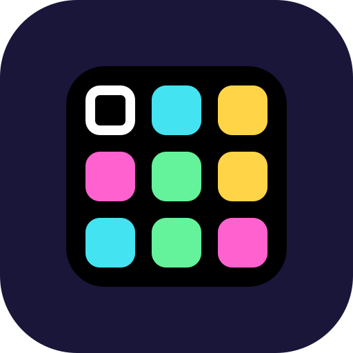
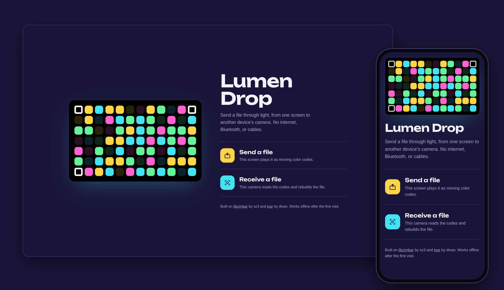
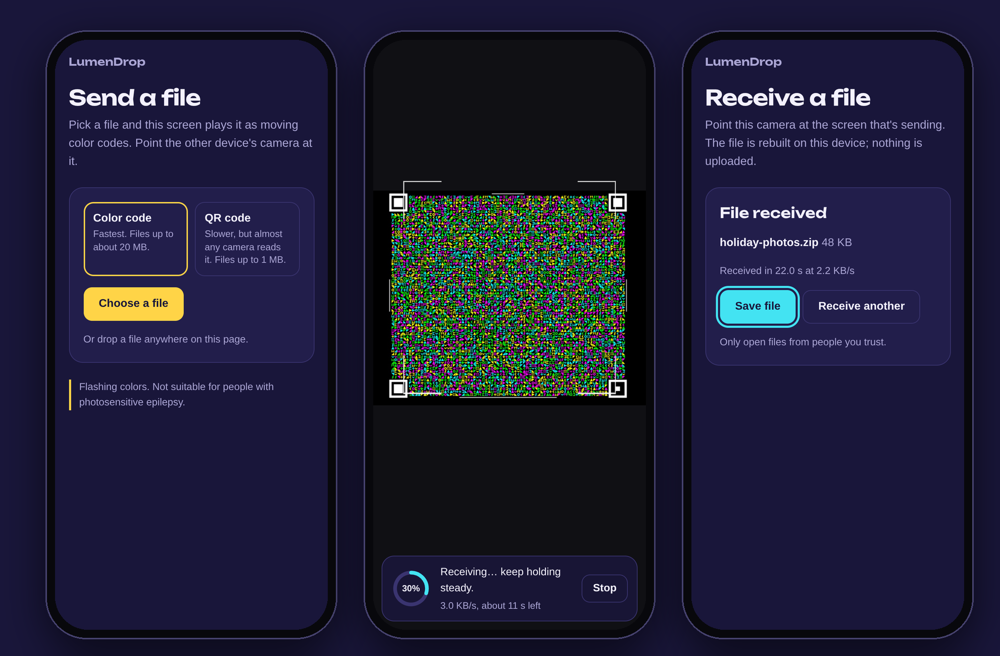
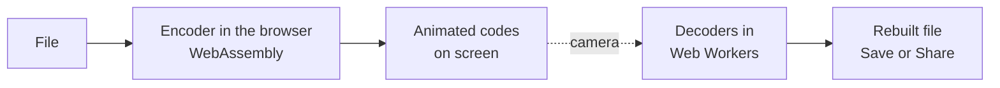
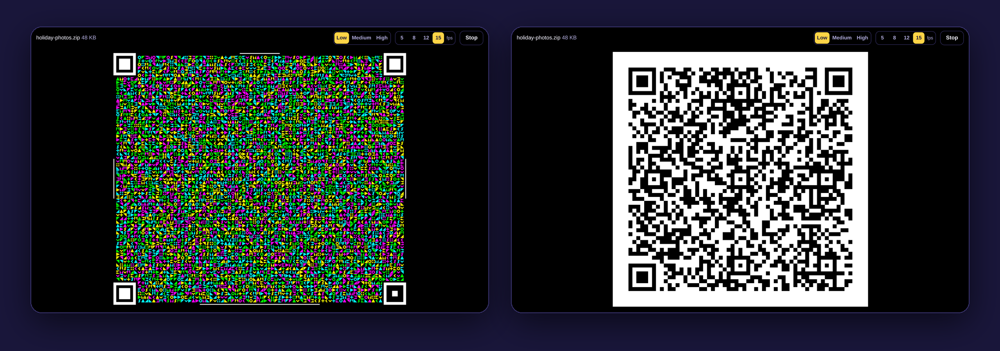

<div align="center">



# Lumen Drop

**Send a file from one screen to another device's camera.**<br>
No internet, Bluetooth, or cables. Works offline once loaded.



</div>

## How it works

The sending screen plays your file as a stream of animated codes. The receiving device points
its camera at the screen, reads the codes, and rebuilds the file. Nothing is uploaded: the file
travels as light, from one screen to the other camera.

<p align="center">
  
</p>

<p align="center"><sub>Choose a file, point the other phone's camera at the code, save the file.</sub></p>



Both sides run entirely in the browser. The server only delivers the app, and a service worker
keeps it on the device, so after the first visit it works with no network at all.

## Two kinds of code

<p align="center">
  
</p>

|  | Color code (default) | QR code |
|---|---|---|
| Built on | [libcimbar](https://github.com/sz3/libcimbar) | [txqr](https://github.com/divan/txqr) |
| Data per frame | about 3.2 KB at Low, 7.5 KB at High | 200 to 600 bytes |
| Files | up to about 20 MB | up to 1 MB |
| Camera | needs a reasonable camera | almost any camera reads it |

The receiver tells which kind is playing by itself; there is nothing to set on that side.
Both send in fountain-coded frames, so the camera can miss frames or start in the middle.

## Use it

1. Open the app once on both devices while online, or install it to the home screen.
2. On the sending device, choose **Send a file**, pick **Color code** or **QR code**, then the file.
3. On the receiving device, choose **Receive a file**, tap **Start camera**, and point it at the
   sending screen with the whole code in view.
4. At 100%, tap **Save file** (or **Share** on phones).

While the code plays, the bar at the top has two controls. Each is remembered on that device:

- **Resolution (Low / Medium / High):** lower resolution draws bigger symbols, which phone
  cameras read more easily, but each frame carries less, so the transfer needs more frames.
  Low is the default. In QR mode the same buttons choose 200, 400 or 600 bytes per code.
- **Speed (5 / 8 / 12 / 15 fps):** slower keeps each frame on screen longer.

The receiver shows the speed and time left as it goes. The color code also shifts a few pixels
every frame; that is libcimbar's design, which lets the receiver drop blurred frames early
([explanation](https://github.com/sz3/libcimbar/issues/127)).

<details>
<summary><b>If the receiver stays at 0%</b></summary>

<br>

The usual cause is the camera blending two codes into one blurry frame, or glare from a bright
screen. The receiver already corrects for glare; if it still can't read the code, try:

1. Turn on the room lights and lower the sending screen's brightness a little.
2. Choose **Low** resolution and **8** (or **5**) fps on the sender.
3. Switch the sender to **QR code**.
4. Open the receiver as `recv.html?camfps=30`, which caps the camera's shutter time.

`recv.html#debug` shows what the camera delivers and what each decoder reports, with a
**Save frame** button for a full-resolution still.

</details>

## Run it

Lumen Drop builds into a single program (about 16 MB) with the whole app inside it: no
other files, no install. Building needs Go 1.22+; running it needs nothing.

```sh
go build -o lumendrop .
./lumendrop                        # open http://127.0.0.1:8080
./lumendrop -addr 127.0.0.1:9000   # another port
```

Build it for another computer by naming its system:

```sh
GOOS=windows GOARCH=amd64 go build -o lumendrop.exe .           # Windows
GOOS=darwin GOARCH=arm64 go build -o lumendrop .                # Mac with Apple silicon
CGO_ENABLED=0 GOOS=linux GOARCH=amd64 go build -o lumendrop .   # Linux (static)
```

By default it answers only on this computer (`127.0.0.1`). That is enough to send from it,
and to receive with its webcam: browsers allow the camera on `localhost` without HTTPS.

**Phones need HTTPS for the camera.** Opening `http://<computer-ip>:8080` from a phone (after
starting with `-addr 0.0.0.0:8080`) shows the app, but receiving won't start. To use a phone,
put the program behind HTTPS, as below.

### Deploy with HTTPS

Copy the program to a server and run it behind [Caddy](https://caddyserver.com/), which gets
HTTPS certificates automatically ([`Caddyfile`](Caddyfile)):

```caddyfile
drop.example.com {
	encode zstd gzip
	reverse_proxy 127.0.0.1:8080
}
```

<details>
<summary>systemd unit (unprivileged, sandboxed)</summary>

```ini
# /etc/systemd/system/lumendrop.service
[Unit]
Description=Lumen Drop
After=network.target

[Service]
ExecStart=/usr/local/bin/lumendrop -addr 127.0.0.1:8080
DynamicUser=yes
NoNewPrivileges=yes
ProtectSystem=strict
ProtectHome=yes
PrivateTmp=yes
Restart=on-failure

[Install]
WantedBy=multi-user.target
```

</details>

The server listens on `127.0.0.1` by default, so it is reachable only through the proxy. Each
start generates the service worker from a hash of the embedded files: after a deploy, an open
page reloads itself once the new version is in, unless a transfer is on screen.

## Security and privacy

- **The codes are not encrypted.** Anyone who can see or film the sending screen can recover
  the file. Send sensitive files only where no one else can watch the screen.
- Received files are untrusted. The app never opens them; it only offers Save or Share.
- Strict Content Security Policy, no third-party requests, no analytics.
- The send screen flashes colors: not suitable for people with photosensitive epilepsy.

## Status

Tested on a real iPhone (Chrome) with a laptop, in both modes, and end to end in headless
Chromium, including a simulated phone camera with glare and blur. Full transfers so far use
small files; the encoder alone has handled 20 MB. In desktop Chromium the color
code encoder runs out of memory somewhere around 30 MB; the page says so instead of failing.
Limits on phones are not yet measured.

## Development

```sh
go test ./...                                     # server: headers, MIME types, service worker
(cd qr && go test ./...)                          # QR codec: round trips through real QR images
node --test --test-concurrency=1 test/browser/    # the app in headless Chromium (Node 22+)
qr/build.sh                                       # rebuild web/vendor/qr/qr.wasm after changing qr/
```

The browser tests record the send screen, play it to the receive page as a fake camera, and
compare the saved file byte for byte. They also cover offline use, updates, and error states.

```
main.go, server.go, sw.go   Go server: embeds web/, security headers, service worker
web/                        the app; libcimbar and QR WebAssembly builds in web/vendor/
qr/                         QR codec (txqr) compiled to WebAssembly
test/browser/               end-to-end tests over the Chrome DevTools Protocol
```

## Credits

- [libcimbar](https://github.com/sz3/libcimbar) by sz3: the color code encoder and decoder
  (MPL-2.0). Its WebAssembly build includes OpenCV, zstd, wirehair, libcorrect and others; their
  licenses are in [`web/vendor/cimbar/third_party/`](web/vendor/cimbar/third_party/).
- [txqr](https://github.com/divan/txqr) by divan: the QR code protocol (MIT), built to
  WebAssembly with go-qrcode, gozxing and gofountain; see [`web/vendor/qr/`](web/vendor/qr/).
- [Unbounded](https://github.com/googlefonts/unbounded) typeface (SIL OFL 1.1).

## License

Lumen Drop's own code is [MIT](LICENSE). Bundled files keep their licenses:
[`web/vendor/cimbar/`](web/vendor/cimbar/README.md) is MPL-2.0 (unmodified libcimbar release
files), [`web/vendor/qr/`](web/vendor/qr/README.md) lists the licenses of what `qr.wasm`
contains, and `web/fonts/` is OFL-1.1.
